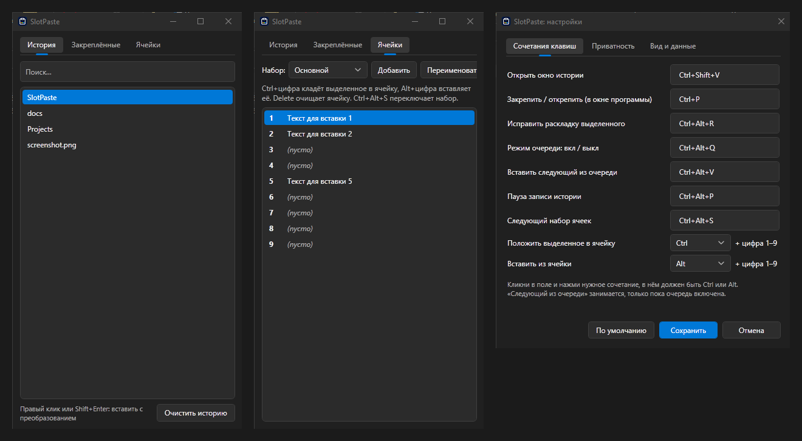

<p align="center">
  
</p>

<h1 align="center">SlotPaste</h1>

<p align="center">
  Clipboard manager for Windows with 9 quick slots, history and paste queue<br>
  Менеджер буфера обмена для Windows: 9 быстрых ячеек, история и очередь вставки
</p>

<p align="center">
  <a href="#english">English</a> · <a href="#русский">Русский</a>
</p>



---

<a id="english"></a>
## English

SlotPaste is a clipboard manager for Windows built with WPF on .NET 10. It sits in the system tray, remembers what you copy and lets you put text into numbered slots and paste it back with a single key combo, without releasing Ctrl or Alt.

### Features

- **History.** Every copied text is saved. Open the history window with a hotkey, search it, and paste an entry into the window you were working in (Enter or double-click). Select several entries and delete them, or clear the whole history.
- **Pinned entries.** Pin important entries to a separate tab. They are never pushed out of the history and never deleted automatically.
- **9 slots.** Ctrl+1…9 puts the selected text into slot 1–9, Alt+1…9 pastes it. You can hold Ctrl or Alt and press several digits in a row.
- **Slot sets.** Several independent sets of 9 slots (for example "Main" and "Work"). Add, rename, delete and switch them with a hotkey.
- **Paste queue.** Turn on queue mode, copy several pieces of text, then paste them one by one in the same order. Queue mode turns itself off when the queue is empty.
- **Paste as…** Right-click an entry (or Shift+Enter) to paste it transformed: plain text, UPPERCASE, lowercase, Title Case, without extra spaces, on one line, or with the keyboard layout fixed.
- **Keyboard layout fix.** Select text typed in the wrong layout and press a hotkey: "ghbdtn" becomes "привет", "руддщ" becomes "hello" (English ↔ Russian).
- **Privacy.**
  - Passwords that password managers mark as private (standard Windows clipboard formats) are not saved.
  - Text copied from listed programs is ignored. Default list: KeePass, KeePassXC, 1Password, Bitwarden.
  - Pause recording with a hotkey or from the tray menu.
  - Limits: keep history for N days and at most N entries (100 by default).
- **Themes.** Light, dark, or follow Windows. The window title bar and the tray menu follow the theme too.
- **Portable mode.** Put an empty `portable.txt` next to `SlotPaste.exe` and all data is stored in a `Data` folder next to the program. Handy for a USB stick.
- **Configurable hotkeys.** Every hotkey can be changed in Settings.

The user interface is currently in Russian.

### Default hotkeys

| Action | Hotkey | Where it works |
|---|---|---|
| Open the history window | Ctrl+Shift+V | everywhere |
| Put the selected text into slot 1–9 | Ctrl+1…9 | everywhere |
| Paste from slot 1–9 | Alt+1…9 | everywhere |
| Fix the layout of the selected text | Ctrl+Alt+R | everywhere |
| Queue mode on / off | Ctrl+Alt+Q | everywhere |
| Paste the next item from the queue | Ctrl+Alt+V | everywhere, only while queue mode is on |
| Pause / resume history recording | Ctrl+Alt+P | everywhere |
| Next slot set | Ctrl+Alt+S | everywhere |
| Pin / unpin the selected entry | Ctrl+P | in the SlotPaste window |
| Paste the selected entry | Enter or double-click | in the SlotPaste window |
| "Paste as…" menu | Shift+Enter or right-click | in the SlotPaste window |
| Delete selected entries / clear a slot | Delete | in the SlotPaste window |
| Clear the search, then hide the window | Esc | in the SlotPaste window |

### Download

Get the latest version on the [Releases](../../releases) page.

- The portable build is a single `SlotPaste.exe` for Windows 10/11 x64. .NET is bundled, so nothing needs to be installed.
- If `portable.txt` lies next to the exe, data is kept in the `Data` folder next to it. Delete `portable.txt` (and the `Data` folder) to store data in your user profile instead.
- The exe is not code-signed, so Windows SmartScreen may show "Windows protected your PC". Click **More info → Run anyway**.

### Where data is stored

| Mode | Folder |
|---|---|
| Normal | `%AppData%\SlotPaste\` |
| Portable (`portable.txt` or a `Data` folder next to the exe) | `Data\` next to `SlotPaste.exe` |

History, pinned entries and slots are in `data.json`, settings are in `settings.json`. The «Вид и данные» (Appearance and data) tab in Settings shows the current folder and opens it.

### Build from source

Requirements: Windows, Visual Studio 2022 or 2026 with the ".NET desktop development" workload, and the .NET 10 SDK.

1. Clone the repository and open the solution (the project file is `ClipApp.csproj`; the program itself is built as `SlotPaste.exe`).
2. Press F5 to build and run.

Portable single-file build: in Visual Studio, right-click the project → **Publish** → choose the **Portable** profile → **Publish**. Or from a terminal in the folder with `ClipApp.csproj`:

```
dotnet publish ClipApp.csproj -p:PublishProfile=Portable
```

The result is `bin\Release\net10.0-windows\win-x64\publish\SlotPaste.exe`. Add an empty `portable.txt` next to it to make it portable.

Do not enable trimming (`PublishTrimmed`): it is not supported for WPF.

### License

[MIT](LICENSE) © 2026 Igor Dorohov

---

<a id="русский"></a>
## Русский

SlotPaste — менеджер буфера обмена для Windows на WPF и .NET 10. Живёт в трее, запоминает всё, что ты копируешь, и позволяет раскладывать текст по пронумерованным ячейкам и вставлять его одним сочетанием клавиш, не отпуская Ctrl или Alt.

### Возможности

- **История.** Всё скопированное сохраняется. Окно истории открывается хоткеем; в нём есть поиск, а запись вставляется в то окно, где ты работал (Enter или двойной клик). Можно выделить несколько записей и удалить их или очистить всю историю.
- **Закреплённые.** Важные записи можно закрепить в отдельной вкладке. Они не вытесняются из истории и никогда не удаляются автоматически.
- **9 ячеек.** Ctrl+1…9 кладёт выделенный текст в ячейку 1–9, Alt+1…9 вставляет его. Ctrl или Alt можно не отпускать и нажимать несколько цифр подряд.
- **Наборы ячеек.** Несколько независимых наборов по 9 ячеек (например, «Основной» и «Работа»). Их можно добавлять, переименовывать, удалять и переключать хоткеем.
- **Очередь вставки.** Включаешь режим очереди, копируешь несколько кусков текста, потом вставляешь их по одному в том же порядке. Когда очередь кончается, режим выключается сам.
- **«Вставить как…».** Правый клик по записи (или Shift+Enter) вставляет её в изменённом виде: обычным текстом, ВЕРХНИМ РЕГИСТРОМ, нижним регистром, Каждое Слово С Заглавной, без лишних пробелов, в одну строку или с исправленной раскладкой.
- **Исправление раскладки.** Выдели текст, набранный не в той раскладке, и нажми хоткей: «ghbdtn» станет «привет», «руддщ» станет «hello» (английская ↔ русская).
- **Приватность.**
  - Пароли, которые менеджеры паролей помечают как секретные (стандартные форматы буфера Windows), не записываются.
  - То, что скопировано из указанных программ, не записывается. По умолчанию это KeePass, KeePassXC, 1Password и Bitwarden.
  - Запись истории можно поставить на паузу хоткеем или из меню в трее.
  - Ограничения: хранить историю N дней и не больше N записей (по умолчанию 100).
- **Темы.** Светлая, тёмная или как в Windows. Под тему подстраиваются и заголовок окна, и меню в трее.
- **Портативный режим.** Положи пустой файл `portable.txt` рядом с `SlotPaste.exe`, и все данные будут храниться в папке `Data` рядом с программой. Удобно для флешки.
- **Настраиваемые хоткеи.** Любое сочетание можно поменять в настройках.

### Горячие клавиши по умолчанию

| Действие | Сочетание | Где работает |
|---|---|---|
| Открыть окно истории | Ctrl+Shift+V | везде |
| Положить выделенное в ячейку 1–9 | Ctrl+1…9 | везде |
| Вставить из ячейки 1–9 | Alt+1…9 | везде |
| Исправить раскладку выделенного текста | Ctrl+Alt+R | везде |
| Режим очереди: вкл / выкл | Ctrl+Alt+Q | везде |
| Вставить следующий из очереди | Ctrl+Alt+V | везде, только пока очередь включена |
| Пауза / продолжить запись истории | Ctrl+Alt+P | везде |
| Следующий набор ячеек | Ctrl+Alt+S | везде |
| Закрепить / открепить выбранную запись | Ctrl+P | в окне SlotPaste |
| Вставить выбранную запись | Enter или двойной клик | в окне SlotPaste |
| Меню «Вставить как…» | Shift+Enter или правый клик | в окне SlotPaste |
| Удалить выбранные записи / очистить ячейку | Delete | в окне SlotPaste |
| Очистить поиск, затем спрятать окно | Esc | в окне SlotPaste |

### Скачать

Последняя версия лежит на странице [Releases](../../releases).

- Портативная сборка — один файл `SlotPaste.exe` для Windows 10/11 x64. .NET уже внутри, ничего устанавливать не нужно.
- Если рядом с exe лежит `portable.txt`, данные хранятся в папке `Data` рядом с ним. Удали `portable.txt` (и папку `Data`), чтобы данные хранились в профиле пользователя.
- Exe не подписан цифровой подписью, поэтому Windows SmartScreen может показать «Система Windows защитила ваш компьютер». Нажми **Подробнее → Выполнить в любом случае**.

### Где хранятся данные

| Режим | Папка |
|---|---|
| Обычный | `%AppData%\SlotPaste\` |
| Портативный (`portable.txt` или папка `Data` рядом с exe) | `Data\` рядом с `SlotPaste.exe` |

История, закреплённые и ячейки лежат в `data.json`, настройки — в `settings.json`. В настройках на вкладке «Вид и данные» видно текущую папку, и её можно открыть кнопкой.

### Сборка из исходников

Нужно: Windows, Visual Studio 2022 или 2026 с рабочей нагрузкой «Разработка классических приложений .NET» и .NET 10 SDK.

1. Склонируй репозиторий и открой решение (файл проекта называется `ClipApp.csproj`, программа собирается в `SlotPaste.exe`).
2. Нажми F5, чтобы собрать и запустить.

Портативный exe одним файлом: в Visual Studio правый клик по проекту → **Опубликовать** → профиль **Portable** → **Опубликовать**. Или в терминале в папке с `ClipApp.csproj`:

```
dotnet publish ClipApp.csproj -p:PublishProfile=Portable
```

Готовый файл: `bin\Release\net10.0-windows\win-x64\publish\SlotPaste.exe`. Положи рядом пустой `portable.txt`, чтобы он стал портативным.

Обрезку (`PublishTrimmed`) не включай: WPF её не поддерживает.

### Лицензия

[MIT](LICENSE) © 2026 Igor Dorohov
